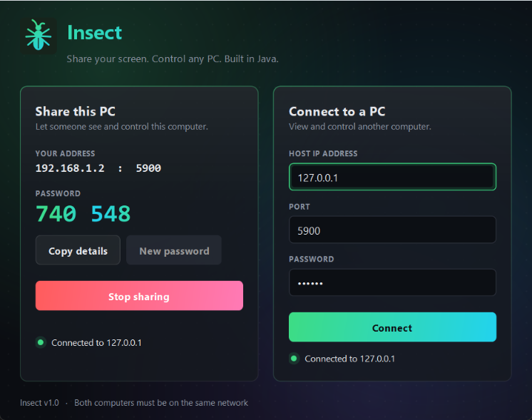

# Insect 🐛 — a mini Parsec in Java

Remote desktop app: see another computer's screen live and control it with your mouse and keyboard.



## Download and run (no Java needed)
1. Download `Insect-Windows.zip` from the [Releases](../../releases) page.
2. Right-click it and choose **Extract All**, then open the folder and double-click **`Insect.exe`**.
3. If Windows shows "Windows protected your PC", click **More info**, then **Run anyway** (the app isn't code-signed).

## How to use
- **On the PC to be controlled:** click **Start sharing**. Note the address and the 6-digit password.
- **On the other PC:** type that IP and password under **Connect to a PC**, then click **Connect**.
- Both PCs must be on the **same Wi-Fi/LAN**. Allow Insect through Windows Firewall if asked.
- Testing on one laptop: start sharing, then connect to `127.0.0.1`.

## Run from source
Requires Java 17+. Double-click `run.bat`, or:
```
javac -d out src\*.java
java -cp out Main
```

## How it works
| Part | Java feature used |
|---|---|
| Screen capture | `java.awt.Robot.createScreenCapture` |
| Compression | `ImageIO` JPEG writer (quality 0.6, max width 1280) |
| Networking | `ServerSocket` / `Socket` over TCP, `DataInput/OutputStream` |
| Concurrency | separate threads for sending frames and receiving input; `SwingWorker` for connecting |
| Remote control | `Robot.mouseMove / mousePress / keyPress` |
| Front end | Swing with a custom-painted animated theme: drifting gradient backdrop, glass cards that slide in, shimmering gradient buttons, pulsing status dots, floating logo, slot-machine password reveal |
| Security | random 6-digit password checked before streaming starts |

## Files
- `Main.java` – entry point
- `InsectApp.java` – main window: "Share this PC" and "Connect to a PC" cards
- `Theme.java` – colors, fonts, custom widgets and the insect logo
- `HostServer.java` – captures screen, streams frames, replays input
- `ClientViewer.java` – displays frames, sends mouse/keyboard events
- `Protocol.java` – shared message types and port

## Safety
- Only while **sharing** is on can someone on your network connect, and only with the password.
- Traffic is not encrypted, so use it on networks you trust.

## Limitations / future work
- ~15 FPS because it sends JPEG images, not a video stream (real Parsec uses H.264/H.265 hardware encoding over UDP).
- Same network only; over the internet it would need port forwarding or a relay server.
- Ideas: chat, file transfer, clipboard sync, audio, quality/FPS slider, TLS encryption.
